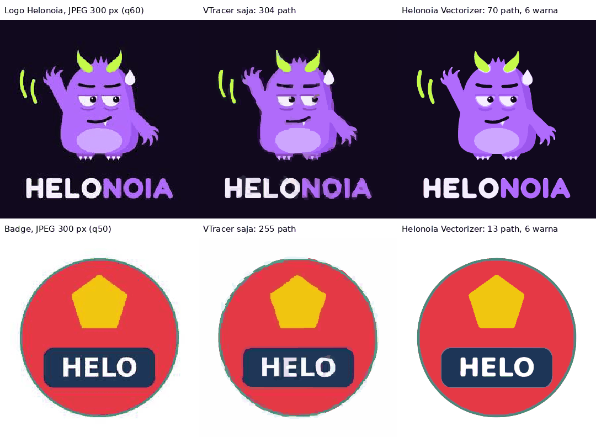

# Helonoia Vectorizer

Script CLI internal untuk mengubah **logo dan ilustrasi flat** (PNG, JPG, WebP, GIF, BMP, TIFF) menjadi SVG. Tool ini dibuat untuk file "kotor" yang biasa dikirim klien, seperti screenshot, JPEG kecil, atau foto dari WhatsApp. Hasilnya tetap berupa bidang warna yang bersih, dengan jumlah path dan warna sesedikit mungkin.



Bukan untuk foto atau gambar bergradasi: semua warna dijadikan bidang rata.

## Instalasi

Butuh Python 3.10 atau lebih baru.

```bash
pip install -r vectorizer/requirements.txt
```

`cairosvg` membutuhkan library Cairo di sistem. Di Ubuntu/Debian biasanya sudah terpasang (kalau belum: `apt install libcairo2`), di macOS pakai `brew install cairo`. Tanpa Cairo, output SVG tetap jalan, tetapi PDF/EPS/PNG dan skor kemiripan di laporan tidak tersedia.

## Pemakaian

```bash
python3 vectorizer/vectorize.py logo.jpg
```

Hasilnya `logo.svg` di sebelah file input, plus laporan singkat:

```
✓ logo.jpg → logo.svg
  ukuran 300×300, diproses 2400×2400
  palet 6 warna: #11091E 77.6% #B06BFC 13.6% #F5EEFE 3.1% #CDA6FF 2.8% #9C56EC 1.6% #C5FD38 1.2%
  67 path · 99 KB · PSNR 29.3 dB · ΔE rata-rata 2.8 · 5.1 s
```

PSNR makin tinggi makin mirip dengan input (di atas 30 dB sudah sangat mirip). ΔE adalah rata-rata selisih warna; di bawah 2 hampir tak terlihat mata.

Contoh lain:

```bash
# Satu folder sekaligus, hasil SVG + PDF ke folder lain
python3 vectorizer/vectorize.py masuk/ -o keluar/ -f svg,pdf

# Kunci warna ke palet brand Helonoia dan buang latarnya
python3 vectorizer/vectorize.py logo.png -p helonoia --remove-bg

# Logo teks: lubang huruf O/A ikut transparan
python3 vectorizer/vectorize.py wordmark.png --remove-bg semua

# Kunci ke warna brand klien
python3 vectorizer/vectorize.py logo.jpg -p "#1D3557,#E63946,#FFFFFF"

# Sederhanakan jadi paling banyak 6 warna
python3 vectorizer/vectorize.py ilustrasi.png -c 6

# Banyak file sekaligus, sekitar 3× lebih cepat
python3 vectorizer/vectorize.py masuk/ -o keluar/ --cepat
```

## Opsi

| Opsi | Fungsi |
| --- | --- |
| `-o`, `--output` | File `.svg` (untuk satu input) atau folder. Default: di sebelah file input. |
| `-c`, `--colors N` | Sederhanakan jadi paling banyak N warna. Warna yang dibuang lebih dulu adalah yang paling sedikit pengaruhnya pada tampilan. Default: semua warna yang ditemukan. Lihat [Menyederhanakan warna](#menyederhanakan-warna). |
| `-p`, `--palette` | Kunci warna ke palet: `helonoia` atau daftar hex dipisah koma. Setiap piksel diberi warna palet yang paling mirip. |
| `-d`, `--detail` | `low`, `medium` (default), atau `high`. Lihat tabel di bawah. |
| `--stacking` | `stacked` (default): bentuk bertumpuk, aman dari celah tipis. `cutout`: bentuk saling memotong dan tidak bertumpuk, cocok untuk cutting/engraving. |
| `--remove-bg` | Buat latar transparan. Latar = warna yang menguasai pinggir gambar. Default (`tepi`): hanya area yang tersambung ke pinggir yang dibuang, jadi warna yang sama di dalam objek (mis. mulut maskot) tetap ada. `--remove-bg semua`: semua area berwarna latar dibuang, termasuk lubang huruf seperti O dan A. |
| `--gradasi` | Eksperimental. Area yang warnanya berubah bertahap (shading halus, bayangan lembut) diisi gradasi SVG, bukan pita-pita warna rata. Lihat [Gradasi](#gradasi-eksperimental). |
| `--cepat` | Sekitar 3× lebih cepat dan file sekitar 2× lebih kecil, dengan bentuk sedikit kurang teliti. Lihat [Presisi](#presisi). |
| `-f`, `--format` | `svg`, `pdf`, `eps`, `png`, boleh lebih dari satu (`svg,pdf`). |
| `--debug` | Simpan juga `*.debug.png`: gambar berwarna rata yang dilacak. Berguna untuk melihat dari mana sebuah warna atau bentuk berasal. |
| `-q`, `--quiet` | Tanpa laporan per file. |

| Detail | Cocok untuk |
| --- | --- |
| `low` | Input sangat kotor atau buram. Lebih sedikit warna, bentuk lebih halus, detail kecil hilang. |
| `medium` | Kebanyakan logo. |
| `high` | Input bersih dengan detail halus: garis tipis, warna yang mirip satu sama lain, sudut tajam. |

## Kalau hasilnya kurang pas

| Masalah | Coba |
| --- | --- |
| Muncul warna yang tidak ada di desain asli | `-c N` dengan jumlah warna yang benar, atau `-p` dengan warna asli |
| Terlalu banyak warna atau path (ilustrasi dengan shading lembut) | `-c N`, mulai dari jumlah warna yang dilaporkan lalu turunkan |
| Detail kecil (pupil, garis tipis) hilang | `-d high` |
| Tepi masih bergerigi atau bernoda | `-d low` |
| Dua warna yang mirip tergabung | `-d high`, atau `-p` dengan kedua warna itu |
| Ada celah tipis antar bentuk di Illustrator | Pastikan `--stacking stacked` (default) |
| Lubang huruf (O, A, B) masih berwarna latar setelah `--remove-bg` | `--remove-bg semua` |

## Menyederhanakan warna

Ilustrasi dengan shading lembut (kilau tepi, gradasi, bayangan bertingkat) bisa menghasilkan banyak warna yang mirip satu sama lain, dan setiap warna menambah path. `-c N` menyederhanakan hasil default menjadi paling banyak N warna.

Warna dibuang satu per satu. Setiap kali, yang dibuang adalah warna yang paling sedikit menambah selisih warna bila pikselnya dipindah ke warna tersisa yang paling mirip (luas area × kenaikan selisih warna). Akibatnya:

- Yang dibuang lebih dulu: warna kembar, kilau tipis, area gradasi kecil, dan artefak JPEG.
- Yang dipertahankan: area yang luas, dan warna yang sangat berbeda walaupun areanya kecil. Contohnya, pada logo Helonoia dengan `-c 4`, lime (1,3% area) tetap ada, sedangkan lilac perut (2,3%, mirip ungu) dilebur.
- Warna yang sangat berbeda dari penggantinya (ΔE ≥ 30) dihitung seolah luasnya minimal 1%. Jadi detail kecil yang kontras, seperti lidah merah muda (0,03% area), tidak ikut terbuang paling awal.

Setiap area dari warna yang dibuang dipindah utuh ke satu warna pengganti, jadi bentuknya tetap rapi dan tidak belang.

Contoh pada ilustrasi monster dengan shading lembut: default 13 warna dan 615 path (PSNR 29,9 dB); `-c 10` menjadi 262 path dengan kemiripan hampir sama (29,6 dB). Laporan menyebut berapa warna awalnya, misalnya `palet 10 warna (disederhanakan dari 13)`, supaya mudah memilih angka berikutnya.

Kalau warna tertentu harus tetap ada (warna brand), pakai `-p` untuk menguncinya.

## Presisi

Ketelitian bentuk paling ditentukan oleh **resolusi kerja**: batas antar warna diletakkan pada grid kerja, jadi grid yang lebih halus menghasilkan tepi yang lebih tepat. Default memakai sisi terpanjang 4000 px (gambar kecil diperbesar sampai 8×); `--cepat` memakai 2000 px (sampai 4×).

| Gambar | `--cepat` | Default |
| --- | --- | --- |
| Logo Helonoia PNG 1000 px | 34,1 dB · 3,9 s · 82 KB | 36,2 dB · 10,6 s · 157 KB |
| Badge PNG 600 px | 36,0 dB · 3,0 s | 37,6 dB · 9,0 s |
| Line-art PNG 600 px | 36,3 dB · 2,4 s | 41,3 dB · 5,8 s |
| Ilustrasi shading lembut 1536 px | 27,1 dB · 4,1 s · 299 KB | 29,9 dB · 11,2 s · 554 KB |

Sebagai pembanding, versi pertama tool ini (setara `--cepat` tanpa perbaikan di bawah) mendapat 33,4 · 33,4 · 33,8 · 26,6 dB untuk keempat gambar itu.

Palet warnanya sama di kedua mode; yang berbeda hanya ketelitian tepi.

Kenapa tidak bisa 100% sama (1:1)? Pada ilustrasi di atas, 94% selisih yang tersisa ada tepat di tepi: tepi gambar asli sedikit lembut (transisi sekitar 2 piksel), sedangkan tepi vektor selalu tajam. Sisanya gradasi halus dan noise/tekstur, yang memang tidak ada di vektor berwarna rata. Untuk logo, tepi tajam justru yang diinginkan.

## Gradasi (eksperimental)

Dengan `--gradasi`, setiap area beserta pita-pita di dalamnya dicoba diisi `<radialGradient>` (elips) atau `<linearGradient>` yang dicocokkan dengan piksel aslinya. Ada dua jalur:

- **Shading di dalam bentuk**, misalnya putih mata yang bergradasi ke lavender. Hanya bagian dalam yang dinilai, supaya pergeseran warna anti-aliasing di tepi tidak dikira gradasi.
- **Bentuk yang memudar ke latar** (bayangan, glow). Area diperluas sekitar 8 px ke latar di sekelilingnya, dan gradasinya memudar sampai ke warna latar.

Gradasi hanya dipakai bila semua syarat ini terpenuhi:

- Selisihnya paling banyak 70% dari versi bidang rata terbaik.
- Warnanya benar-benar berubah (rentang minimal ΔE 10).
- Perubahannya bertahap. Pupil hitam di tengah putih mata bukan gradasi.

Pada gambar flat (logo, badge, line-art) tidak ada yang berubah. Dengan `--remove-bg`, bayangan yang menyentuh latar dibuat memudar ke transparan.

Batasan: bayangan yang intinya rata dengan tepi lembut yang tidak merata (pendek di atas-bawah, panjang di ujung) tidak cocok dengan satu gradasi elips, jadi tetap menjadi pita. Bayangan seperti itu paling tepat dibuat dengan efek blur (`feGaussianBlur`), tetapi efek itu tidak dirender oleh cairosvg, yang dipakai di sini untuk PDF/PNG.

## Cara kerja

1. **Ukuran kerja.** Gambar kecil diperbesar dan gambar besar diperkecil sampai sisi terpanjang sekitar 4000 px (lihat [Presisi](#presisi)).
2. **Denoise.** Non-local means membersihkan artefak JPEG tanpa mengaburkan tepi.
3. **Palet**, ditaksir pada resolusi standar (2000 px) karena di sana ambangnya disetel; pada resolusi lebih tinggi noise JPEG ikut membesar dan terlihat seperti warna tersendiri.
   - Warna diambil dari bagian dalam area yang rata, bukan dari tepinya: dipecah jadi banyak cluster (k-means di ruang warna Lab), lalu yang hampir sama digabung.
   - Warna yang terlewat, misalnya garis tipis, ditambahkan bila bukan campuran anti-aliasing dua warna yang sudah ada.
   - Warna aksen yang sangat berbeda (ΔE > 30 dari semua warna lain) tetap ditambahkan walau hanya 0,02% area, misalnya lidah merah muda di wajah ungu. Agar ringing JPEG tidak ikut masuk, warna aksen hanya dipertahankan bila ada bagiannya yang cukup tebal (memuat lingkaran berdiameter sekitar 5 px), bukan sekadar pita tipis di tepi.
4. **Warna akhir dari gambar asli.** Bila sebagian besar piksel bernilai persis sama (PNG bersih), hex itu yang dipakai, jadi `#B26BFF` tetap `#B26BFF`. Ini dilakukan sebelum piksel diberi warna, karena warna yang meleset sedikit saja sudah menggeser letak tepi.
5. **Beri warna tiap piksel, lalu buang artefak tepi.** Warna yang hanya muncul sebagai pita tipis di tepi dan mirip warna lain (ringing atau chroma bleed JPEG), atau merupakan campuran dua warna lain, dilebur ke warna yang paling mirip.
6. **Haluskan tepi.** Setiap piksel ikut warna yang paling dominan di sekitarnya.
   Dengan `-c N`, warna lalu disederhanakan (lihat di atas) dan tepinya dihaluskan sekali lagi.
7. **Lacak dengan [VTracer](https://github.com/visioncortex/vtracer)** (ambang penyambungan kurva lebih rapat pada mode default), lalu kunci setiap `fill` ke palet dan kembalikan ukuran SVG ke ukuran asli (koordinat memakai `viewBox` ukuran kerja).

Latar belakang riset dan perbandingan dengan kompetitor ada di [`riset/RISET-VEKTORISASI.md`](riset/RISET-VEKTORISASI.md).

## Batasan

- Belum ada **centerline** (garis jadi satu stroke). Garis selalu jadi bidang tipis.
- Belum ada **deteksi bentuk**: lingkaran dan persegi tetap berupa path, bukan `<circle>` atau `<rect>`.
- Garis yang sangat tipis (sekitar 1,5 px atau kurang) pada JPEG kecil bisa berubah warna, karena JPEG menyimpan warna dengan resolusi setengah. Pakai `-p` atau `-c` untuk memperbaikinya.
- Foto dan gradasi akan jadi bidang-bidang warna (posterize).

## Test

```bash
python3 -m pytest vectorizer/tests -q
```

Test memakai gambar sintetis dengan warna yang diketahui pasti ([`tests/samples.py`](tests/samples.py)) dan logo Helonoia. Yang diperiksa: warna yang ditemukan, kemiripan hasil render dengan input, ketahanan terhadap JPEG, setiap opsi, dan CLI.
