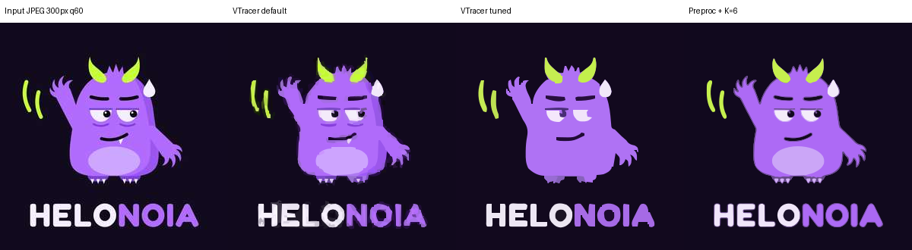

# Riset: Vektorisasi Gambar (raster → vektor)

Tanggal riset: 13 November 2026 · Branch: `Vectorizer`

Tujuan: memahami cara kerja vektorisasi, apa yang ditawarkan kompetitor, dan bahan apa yang bisa kita pakai untuk membuat script atau tool vektorisasi sendiri.

---

## 1. Ringkasan

- **Inti vektorisasi:** gambar dipecah jadi area warna, batas tiap area diubah jadi garis lalu kurva, dan hasilnya disusun sebagai SVG. Kualitas hasil paling banyak ditentukan oleh dua hal: **pembersihan dan penyederhanaan warna sebelum tracing**, serta **fitting kurva dan sudut sesudahnya**.
- **Kompetitor terkuat adalah Vectorizer.AI.** Opsi API-nya terdokumentasi lengkap, jadi bisa kita jadikan daftar fitur acuan. Harganya $9,99/bulan untuk web, dan $0,20 sampai $0,05 per gambar lewat API.
- **Fondasi open source terbaik untuk kita adalah [VTracer](https://github.com/visioncortex/vtracer)**: berwarna, cepat, berlisensi MIT, dan langsung bisa dipakai dari Python (`pip install vtracer`). Potrace lebih matang, tetapi hanya hitam-putih dan berlisensi GPL.
- **Uji coba kita:** VTracer apa adanya menghasilkan "noise" pada JPEG kecil (312 path, 308 warna). Setelah diberi tahap praproses sederhana (upscale, denoise, kuantisasi 6 warna), hasilnya jauh lebih bersih (54 path) dan lebih mirip input (PSNR 26,1 → 28,5 dB). Jadi nilai tambah tool kita ada di **praproses dan pascaproses**, bukan di mesin tracing-nya.
- **Rekomendasi MVP:** CLI Python dengan alur *praproses → kuantisasi palet → VTracer → rapikan SVG*, plus opsi **kunci palet** (misalnya palet brand Helonoia). Detailnya ada di bagian 6.

---

## 2. Cara kerja vektorisasi

Hampir semua tool (komersial maupun open source) mengikuti alur yang sama:

| # | Tahap | Yang dilakukan | Contoh teknik |
| --- | --- | --- | --- |
| 1 | Praproses | Membersihkan noise JPEG, memperbesar gambar kecil, menghapus latar | Upscale bicubic/AI, bilateral filter, median filter, background removal |
| 2 | Segmentasi warna | Menentukan berapa warna yang dipakai dan piksel mana masuk warna apa | K-means, clustering hierarkis (VTracer), palet yang ditentukan pengguna |
| 3 | Ekstraksi kontur | Mengambil batas tiap area warna | Path tracing pada grid piksel, `cv2.findContours` |
| 4 | Penyederhanaan | Mengubah tepi bergerigi jadi poligon sederhana | Poligon optimal (Potrace), Douglas-Peucker |
| 5 | Fitting kurva | Mengubah poligon jadi kurva halus dan mendeteksi sudut tajam | Bezier kubik, busur lingkaran/elips, ambang sudut |
| 6 | Deteksi bentuk *(lanjutan)* | Mengenali lingkaran, elips, persegi membulat, dan simetri | Fitting geometri, deteksi simetri |
| 7 | Penyusunan layer | Menentukan apakah bentuk ditumpuk atau dipotong rapat | *stacked* (bertumpuk) vs *cutout* (bersebelahan) |
| 8 | Output | Menulis SVG/PDF/EPS/DXF lalu mengecilkan file | Pembulatan koordinat, SVGO/Scour |

Istilah yang sering muncul di semua tool:

- **Speckle / noise / turdsize:** area lebih kecil dari X piksel dibuang.
- **Corner threshold / alphamax:** seberapa tajam sudut sebelum dianggap sudut (bukan lengkung).
- **Stacked vs cutout:** *stacked* lebih aman dari celah tipis, sedangkan *cutout* lebih rapi untuk cutting dan engraving.
- **Centerline tracing:** garis diubah jadi satu stroke (bukan dua tepi yang membentuk bidang). Penting untuk sketsa, tanda tangan, dan plotter. **Vectorizer.AI tidak mendukung ini.**

---

## 3. Kompetitor

### 3.1 Perbandingan singkat

| Tool | Model | Harga (perkiraan) | Kekuatan | Catatan |
| --- | --- | --- | --- | --- |
| **Vectorizer.AI** | Web + API | Web $9,99/bln (preview gratis, unduh berbayar). API $0,20 → $0,05 per gambar (paket 50 s.d. 100.000 kredit/bln) | Kualitas trace paling sering dinilai terbaik; deteksi bentuk & simetri; sub-piksel | Tanpa centerline; input maks ~3 MP; file disimpan 24 jam |
| **Vector Magic** | Web + desktop | Desktop sekitar $295 sekali bayar; harga bulanan web berbeda-beda antar sumber ($6,49 atau $9,95) | Satu-satunya opsi offline yang populer; memakai anti-aliasing sebagai informasi tepi | Algoritmanya tidak dipublikasikan; otomatis mengusulkan palet 2–12 warna |
| **Adobe Illustrator: Image Trace** | Desktop | Sekitar $23/bln | Kontrol manual paling lengkap; standar industri | Parameter: Paths, Corners, Noise, Method (Abutting/Overlapping), Ignore Color |
| **Recraft** | Web + API | Vectorize via API pihak ketiga sekitar $0,01–0,04 per gambar (belum dicek di halaman resmi) | Bisa membuat vektor dari prompt sekaligus vektorisasi | Lebih fokus ke generasi gambar |
| **Inkscape: Trace Bitmap** | Desktop, gratis | Gratis | Membundel Potrace dan AutoTrace | Mode warna kurang rapi dibanding tool komersial |

> Sebagian besar artikel "best vectorizer 2026" ditulis vendor atau afiliasi, jadi peringkatnya hanya petunjuk arah. Harga Vector Magic dan Recraft berbeda-beda antar sumber, jadi perlu dicek ulang sebelum dipakai untuk penetapan harga.

### 3.2 Vectorizer.AI sebagai acuan fitur

Dibaca langsung dari halaman resmi (home, pricing, API docs, output options):

**Klaim teknis**
- Bentuk yang dikenali: lingkaran, elips, persegi panjang (termasuk sudut membulat), segitiga sama kaki, bintang, dan bentuk D, dengan rotasi bebas.
- Jenis kurva: garis, busur lingkaran, busur elips, Bezier kuadratik dan kubik (tidak hanya Bezier kubik).
- Presisi sub-piksel: memakai nilai piksel anti-aliasing untuk menempatkan tepi.
- Deteksi simetri cermin dan rotasi.
- "Vector Graph": bentuk yang bersentuhan berbagi tepi yang persis sama, jadi tidak ada celah atau tumpang-tindih.
- Input ARGB 32-bit, termasuk transparansi parsial.

**Opsi API yang layak ditiru** (nama persis dari dokumentasi)

| Opsi | Nilai | Fungsi |
| --- | --- | --- |
| `processing.max_colors` | 0–256 (0 = otomatis) | Batas jumlah warna |
| `processing.palette` | `#FF0000 -> #00FF00 ~ 0.02;` | Kunci palet, ganti warna, toleransi |
| `processing.shapes.min_area_px` | 0–100, default 0,125 | Buang bentuk kecil |
| `output.file_format` | svg, eps, pdf, dxf, png | Format output |
| `output.draw_style` | fill_shapes, stroke_shapes, stroke_edges | Isi vs garis (untuk laser/vinyl) |
| `output.shape_stacking` | cutouts, stacked | Susunan layer |
| `output.group_by` | none, color, parent, layer | Pengelompokan di SVG |
| `output.curves.allowed.*` | quadratic_bezier, cubic_bezier, circular_arc, elliptical_arc | Jenis kurva yang boleh dipakai |
| `output.curves.line_fit_tolerance` | 0,001–1,0, default 0,1 | Kasar ↔ halus (preset 0,30 / 0,1 / 0,03 / 0,01 px) |
| `output.gap_filler.*` | enabled, stroke_width… | Menutup celah tipis antar bentuk |
| `output.svg.adobe_compatibility_mode` | true/false | Hanya garis + Bezier kubik agar aman di Illustrator |
| `output.size.*` | scale, width, height, unit, dpi | Ukuran fisik output |

**Batas input:** PNG, JPG, GIF, BMP, WebP. Maksimal 30 MB, dan gambar diperkecil ke sekitar 3 megapiksel sebelum diproses.

**Celah yang bisa kita isi:** centerline tracing, pemrosesan offline atau batch tanpa biaya per gambar, dan palet brand bawaan.

---

## 4. Bahan open source

| Library | Lisensi | Warna? | Bahasa | Catatan |
| --- | --- | --- | --- | --- |
| **[VTracer](https://github.com/visioncortex/vtracer)** | MIT | Ya | Rust, binding Python (`pip install vtracer`) | Clustering hierarkis, mode spline/polygon, stacked/cutout. **Pilihan utama.** |
| **[Potrace](https://potrace.sourceforge.net/)** | GPL | Tidak (hitam-putih) | C (`libpotrace`), port Python `potracer` | Algoritma klasik: poligon optimal → Bezier. Parameter `turdsize`, `alphamax`, `opttolerance`. Bagus untuk logo satu warna, teks, dan siluet. |
| **AutoTrace** | GPL | Ya | C | Satu-satunya dari daftar ini yang punya **centerline**. Rilis terakhir 0.31.10 (2024). |
| **OpenCV** | Apache 2.0 | Alat bantu | Python | Untuk praproses (denoise, k-means) dan deteksi bentuk (`fitEllipse`, `minEnclosingCircle`, `approxPolyDP`). |
| **LIVE + DiffVG** (CVPR 2022) | Riset | Ya | PyTorch | Mengoptimasi path agar render-nya cocok dengan gambar. Hasilnya berlapis rapi tapi **lambat** (butuh GPU, menit per gambar). |
| **StarVector** (CVPR 2025) | Apache 2.0 (kode); basis StarCoder perlu dicek | Ya | Model 1B/8B | LLM yang menulis kode SVG dari gambar. Bagus untuk ikon/diagram, kurang cocok untuk gambar kompleks. |
| **OmniSVG** (2025) | Apache 2.0 (bobot); dataset MMSVG CC BY-NC-SA | Ya | Model 4B | Sama seperti StarVector; dataset-nya non-komersial. |

**Catatan lisensi:** kode GPL (Potrace, AutoTrace) boleh dipakai di server tanpa membuka kode kita. Tetapi kalau tool-nya **kita bagikan** (desktop app atau script yang dikirim ke klien), kode kita juga harus GPL. VTracer (MIT) dan OpenCV (Apache 2.0) aman untuk keduanya.

**Pendekatan model AI (StarVector/OmniSVG/LIVE):** menarik untuk fase berikutnya, tetapi butuh GPU, lambat, dan hasilnya belum stabil untuk produksi. Untuk MVP, pendekatan klasik + praproses yang baik sudah memberi hasil yang bisa dijual.

---

## 5. Uji coba kita

Diuji dengan VTracer 0.6.15 pada logo Helonoia (`helonoia/helonoia_logo.png`).

### 5.1 Input bersih (PNG 1000×1000)

| Mode | PSNR* | Ukuran SVG | Path | Waktu |
| --- | --- | --- | --- | --- |
| Spline (default) | 31,0 dB | 96 KB | 43 | 0,13 s |
| Polygon | 31,4 dB | 10 KB | 43 | 0,12 s |
| Spline, `path_precision=2` | n/a | 39 KB | 43 | n/a |

Pada input bersih VTracer sudah bagus dan sangat cepat. Masalah utamanya ukuran file: mode spline 10× lebih besar dari polygon, sehingga perlu pembulatan koordinat dan optimasi SVG.

### 5.2 Input "kotor" (logo diperkecil jadi 300 px, JPEG kualitas 60)

Ini mensimulasikan file yang biasanya dikirim pelanggan (screenshot, foto WhatsApp).

| Pendekatan | PSNR* | Ukuran SVG | Path | Warna |
| --- | --- | --- | --- | --- |
| VTracer default | 26,1 dB | 214 KB | 312 | 308 |
| VTracer, parameter diperketat | 24,4 dB | 33 KB | 25 | 24 |
| **Praproses + K=6 lalu VTracer** | **28,5 dB** | 203 KB | 54 | 24 |
| Praproses + K=8 lalu VTracer | 28,5 dB | 260 KB | 85 | 64 |
| Praproses + K=12 lalu VTracer | 27,4 dB | 472 KB | 155 | 132 |

\* PSNR = kemiripan hasil render SVG dengan gambar input; makin tinggi makin mirip. Untuk input kotor, pembandingnya JPEG itu sendiri, jadi angka ini mengukur kesetiaan, bukan kebersihan.

Praproses yang dipakai: upscale 3× → bilateral filter → median filter → k-means K warna → median filter.

Uji ini bisa diulang dengan `python3 vectorizer/riset/uji_vtracer.py` (dari root repo).




*Dari kiri: input JPEG, VTracer default, VTracer diperketat, praproses + K=6.*

**Pengamatan:**
- **Default:** ada "halo" di setiap tepi. Piksel anti-aliasing dan artefak JPEG menjadi bentuk tersendiri.
- **Parameter diperketat:** bersih, tetapi **detail hilang**: pupil mata, bercak perut, dan gigi lenyap. Mengatur parameter VTracer saja tidak cukup.
- **Praproses + K=6:** bersih **dan** detail tetap ada. Ini bukti bahwa tahap praproses adalah tempat nilai tambah kita.
- **Sisa masalah:**
  - Jumlah warna akhir (24) masih lebih banyak dari K (6), karena median filter dan VTracer membuat warna campuran. Perlu langkah "snap ke palet" setelah tracing.
  - File masih besar karena koordinat ikut diperbesar 3×. Perlu skala balik dan pembulatan koordinat.
  - K masih dipilih manual. Perlu deteksi jumlah warna otomatis (misalnya metode elbow atau silhouette, seperti Vector Magic yang mengusulkan palet 2–12 warna).

---

## 6. Rekomendasi untuk tool kita

### MVP (script/CLI Python)

```
vectorize input.jpg -o output.svg [--colors auto|N] [--palette helonoia|"#120B1E,#B26BFF,..."]
                                  [--detail low|medium|high] [--mode color|bw] [--stack stacked|cutout]
```

Alur:
1. **Praproses:** upscale gambar kecil, denoise yang menjaga tepi, dan opsi hapus latar.
2. **Kuantisasi palet:** K otomatis atau manual, atau **kunci ke palet tertentu** (misalnya enam warna brand Helonoia).
3. **Tracing:** VTracer untuk mode warna; Potrace (`potracer`) untuk mode hitam-putih, karena lebih rapi untuk teks dan logo satu warna.
4. **Pascaproses:**
   - Snap setiap `fill` ke warna palet terdekat, lalu gabungkan path berwarna sama.
   - Skala balik koordinat dan bulatkan ke 1–2 desimal.
   - Buang path yang sangat kecil.
5. **Output:** SVG lebih dulu. PDF/EPS bisa menyusul lewat `cairosvg` atau Inkscape CLI.
6. **Laporan kualitas:** jumlah path, jumlah warna, ukuran file, dan skor kemiripan, supaya hasil bisa dicek otomatis.

### Fase berikutnya (pembeda dari kompetitor)

- **Centerline mode** untuk sketsa, tanda tangan, dan file laser/plotter (Vectorizer.AI tidak punya).
- **Deteksi bentuk:** lingkaran, elips, dan persegi membulat diganti dengan elemen SVG asli (`<circle>`, `<ellipse>`, `<rect rx>`).
- **Mode cutting:** `stroke_edges` ala Vectorizer.AI untuk vinyl dan laser.
- **Web UI atau API** dengan pratinjau sebelum unduh.
- **Eksperimen model AI** (StarVector/OmniSVG) khusus untuk ikon sederhana.

---

## 7. Pertanyaan yang perlu diputuskan

1. **Bentuk tool:** script/CLI internal dulu, atau langsung web app untuk pelanggan?
2. **Jenis gambar utama:** logo dan ilustrasi flat (seperti maskot Helonoia), foto, atau sketsa/garis? Jawabannya menentukan apakah centerline masuk MVP.
3. **Distribusi:** kalau tool akan dibagikan atau dijual sebagai aplikasi, hindari komponen GPL (Potrace/AutoTrace) atau siapkan alternatifnya.
4. **Format output wajib** selain SVG: PDF, EPS, atau DXF (untuk cutting)?

---

## Sumber

- Vectorizer.AI: [beranda](https://vectorizer.ai/), [harga](https://vectorizer.ai/pricing), [API](https://vectorizer.ai/api), [dokumentasi API](https://vectorizer.ai/api/documentation), [output options](https://vectorizer.ai/api/outputOptions)
- Vector Magic: [cara pakai](https://vectormagic.com/support/tutorials/how-to-use-vector-magic), [tips](https://vectormagic.com/support/tutorials/tips-and-tricks), [alternatif & harga (pihak ketiga)](https://www.svggenie.com/blog/vector-magic-alternatives-2026)
- Adobe Illustrator: [Image Trace panel options](https://helpx.adobe.com/lv/illustrator/using/tracing-artwork-live-trace-or.html), [presets](https://helpx.adobe.com/illustrator/using/image-trace-presets.html)
- Recraft: [dokumentasi vectorize](https://www.recraft.ai/docs/api-reference/tools/vectorize), [harga fal.ai](https://fal.ai/models/fal-ai/recraft/vectorize/llms.txt)
- Perbandingan (sebagian ditulis vendor): [Recraft blog](https://www.recraft.ai/blog/best-image-vectorizers), [Atomm](https://www.atomm.com/blog/2506-best-image-vectorizer), [PerfectVector](https://perfectvector.com/blog/best-ai-vectorizers-2026)
- Open source: [VTracer](https://github.com/visioncortex/vtracer), [vtracer di PyPI](https://pypi.org/project/vtracer/), [Potrace man page](https://potrace.sourceforge.net/potrace.html), [Wikipedia: perbandingan software raster-ke-vektor](https://en.wikipedia.org/wiki/Comparison_of_raster-to-vector_conversion_software)
- Riset: [LIVE (CVPR 2022)](https://openaccess.thecvf.com/content/CVPR2022/papers/Ma_Towards_Layer-Wise_Image_Vectorization_CVPR_2022_paper.pdf), [StarVector](https://arxiv.org/abs/2312.11556), [OmniSVG](https://arxiv.org/abs/2504.06263), [model OmniSVG](https://huggingface.co/OmniSVG/OmniSVG)
